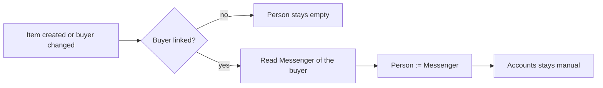
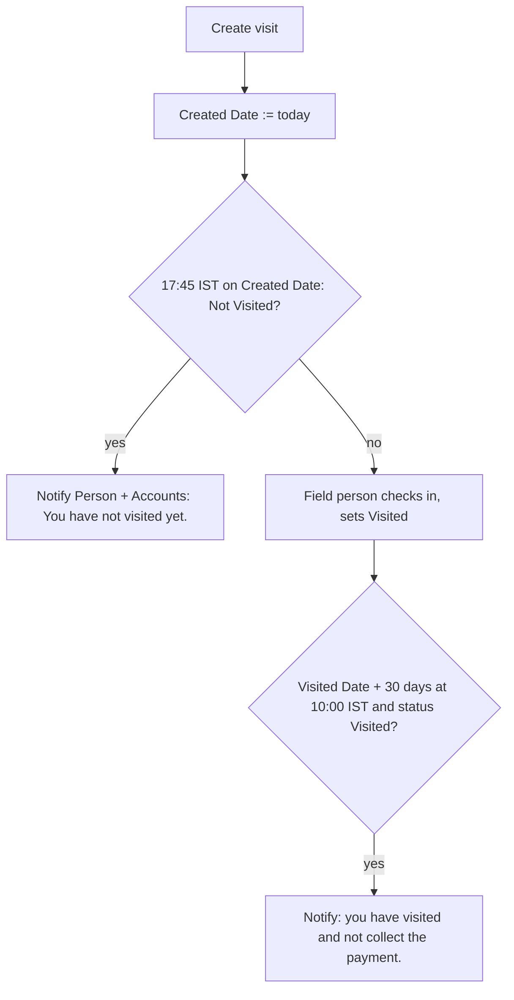
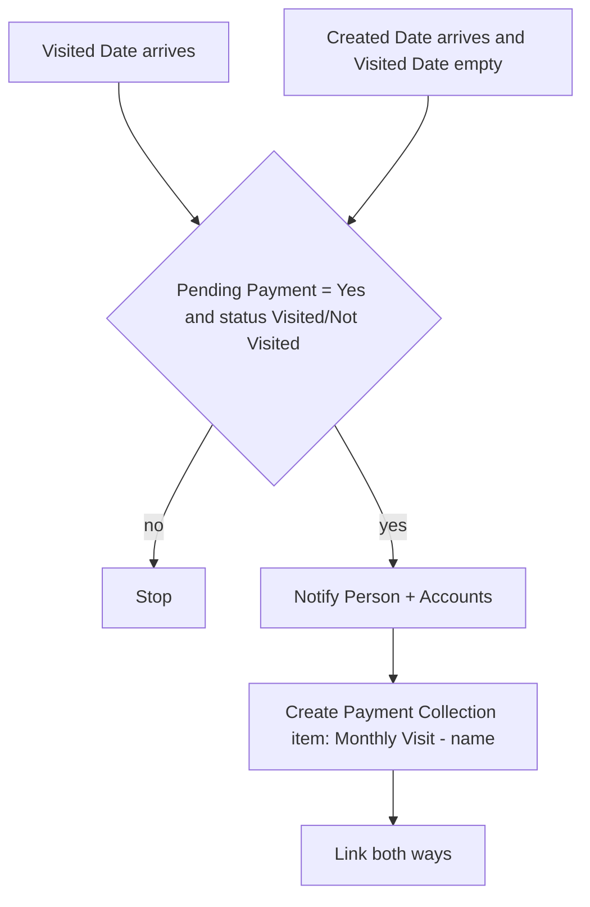
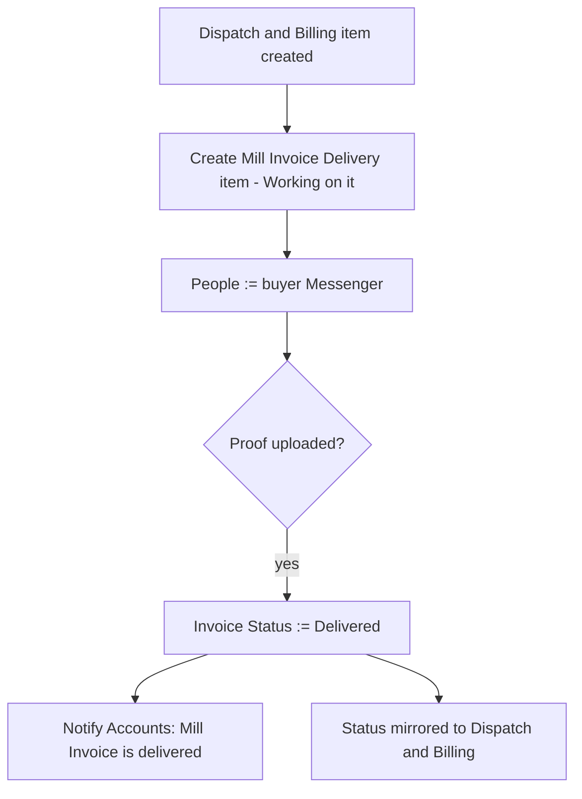
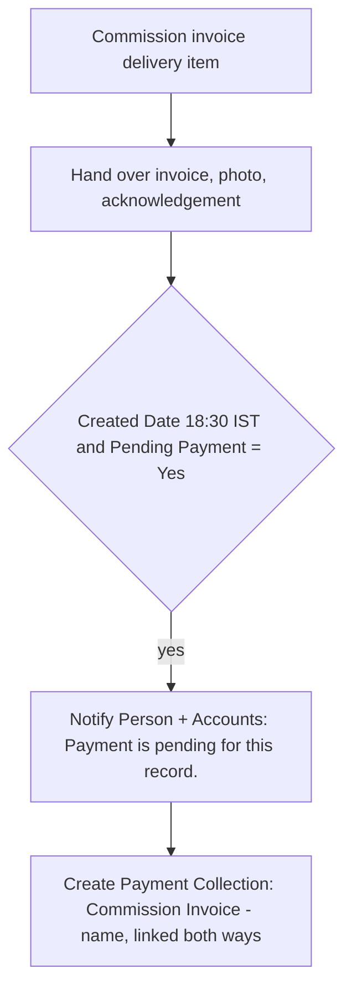
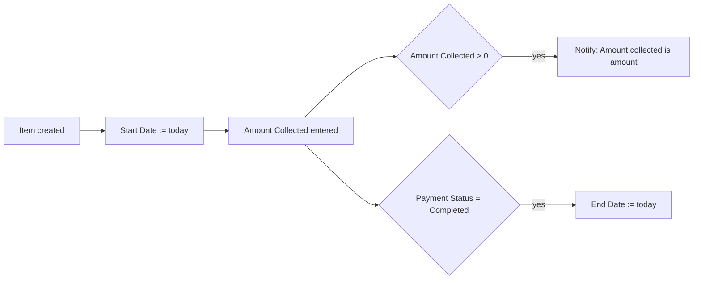
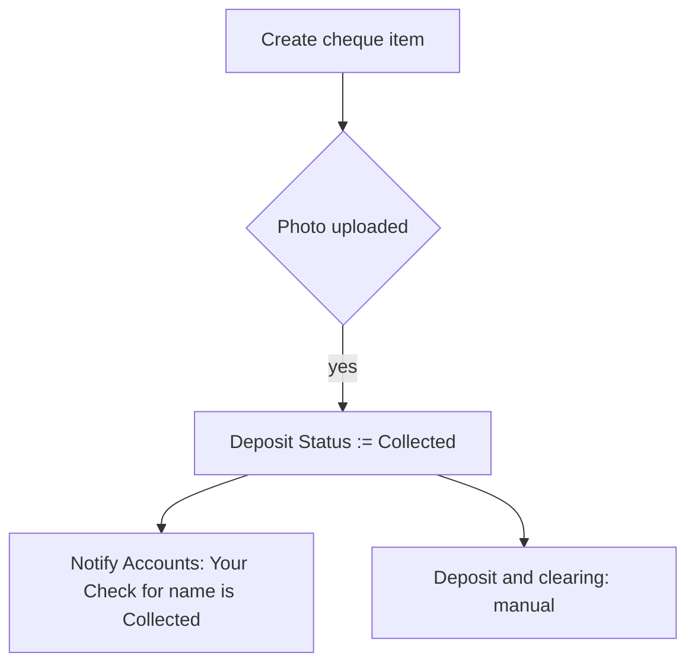
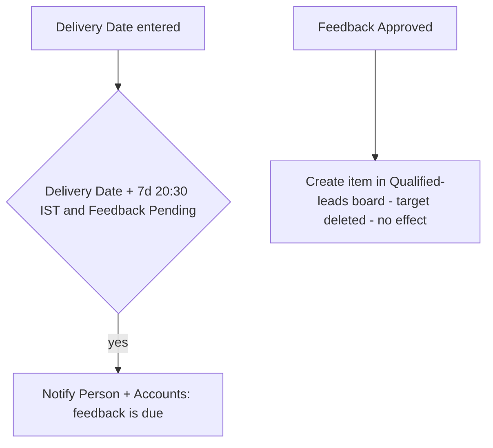

# 03. Workflow analysis

Nine end-to-end workflows. For each: how it starts, who starts it, required information, receiving board, statuses, responsible people, conditions, blocked/completed/error handling, effects on other boards. Automation numbers (A-nn) refer to document 05.

## WF-1. Person from the buyer's Messenger (assignment)

| Aspect | Detail |
|---|---|
| Boards | Monthly Visit, Mill Invoice Delivery, Commission Invoice Delivery, Cheque Collection, Sample Delivery (not Payment Collection, not Freight) |
| Starts | An item is created, or its buyer relation changes |
| Initiator | Whoever creates the item or links the buyer |
| Needs | The buyer relation filled; the buyer's **Messenger** people column filled on Buyers & Suppliers |
| Action | Person/People column := the Messenger people of the linked buyer (A-21..A-30, the "update column from lookup" recipes). "Apply on existing items" is off |
| Accounts | **Not set automatically**; people enter it |
| Blocked | If the buyer has no Messenger, Person stays empty and no one is notified; there is no fallback |
| Completed | n/a |
| Errors | None visible; no run history (0 executions recorded) |

## WF-2. Monthly Visit lifecycle

| Aspect | Detail |
|---|---|
| Starts | A person creates a Monthly Visit item (by hand or Creation Form). monday has **no** rule creating visits monthly (no recurring automation) |
| Information | Buyer (required for Person), Pending Payment Status, later Visited Date, GPS, times, summary |
| Responsible | Person (field staff); Accounts (copied on reminders) |
| Statuses | Visited/Not Visited: Not Visited -> Visited -> Completed. Pending Payment: No / Yes |
| Rules | On creation Created Date = today (A-1). At 17:45 IST on the Created Date, if still Not Visited: notify Person + Accounts "You have not visited yet." (A-2). Thirty days after Visited Date at 10:00 IST, if Visited: notify "you have visited and not collect the payment." (A-3, no pending-payment condition) |
| Blocked | No blocked state; "Not Visited" is the blocked state in effect |
| Completed | Visited/Not Visited = Completed; nothing happens automatically |
| Effects | Escalation (WF-3) when Pending Payment = Yes |

## WF-3. Unpaid visit escalation to Payment Collection (30/45/60 days)

Six automations (A-4..A-9): three on **Visited Date** and three on **Created Date**.

| Aspect | Detail |
|---|---|
| Trigger | Visited-Date branch (A-4, A-5, A-6): Visited Date arrives at 18:00, 22:15, 22:45 IST. Created-Date branch (A-7, A-8, A-9): Created Date arrives at 18:15, 22:15, 22:45 IST; additionally **Visited Date is empty** |
| Conditions | Pending Payment Status = Yes AND Visited/Not Visited is Visited or Not Visited (any of the two, i.e. not Completed) |
| Actions | Notify Person + Accounts, then create an item in **Payment Collection** named "Monthly Visit - {item name}" linked both ways (Connected Boards <-> link to Payment Collection) |
| Wording | Visited branch: "you have visited and not collected the payment after N days". Created branch: "you have not visited and not collected the payment after N days" (the 60-day Created-branch automation A-9 still says "you have visited": copy error in monday) |
| Offsets | The messages say 30/45/60 days but the stored trigger configuration shows **no offset** for these six (only A-3 stores "30 days"). **Unverified**: the editor may show the offset; the 22:15 and 22:45 times look like test settings. Must be confirmed in the monday editor |
| Duplicates | None prevented: every step creates a new Payment Collection item for the same visit (up to three per visit per branch) |

## WF-4. Mill invoice delivery

| Aspect | Detail |
|---|---|
| Starts | A Dispatch and Billing item is created -> monday creates a Mill Invoice Delivery item "<name> - Task", Status Working on it, linked both ways (D&B automation A5; see `CRMMasterPlan.md` P2-3) |
| Information | Buyers (for Person), Delivery Mode, proof, GPS, Invoice Amount. Invoice number/date/supplier arrive as mirrors |
| Responsible | People (Messenger) deliver; Accounts are notified |
| Rule | When **Delivery Proof Upload** changes: notify Accounts "Hey, {name}, Mill Invoice is delivered" (A-10) and set **Invoice Status = Delivered**. The automation does not change Status |
| Blocked | Status = Stuck (by hand); no automation reacts |
| Completed | Invoice Status Delivered; row stays in the board |
| Effects | Status is mirrored into Dispatch and Billing "Mill Invoice Status" |

## WF-5. Commission invoice delivery and pending payment

| Aspect | Detail |
|---|---|
| Starts | A Commission Invoices item links a Commission Invoice Delivery item (automation on that board; unverified) |
| Information | Commission invoice link (amount mirrors), buyer, acknowledgement, photo, GPS, Pending Payment Status |
| Rule | On the **Created Date at 18:30 IST**, if Pending Payment Status = Yes: notify Person + Accounts "Payment is pending for this record." and create a **Payment Collection** item "Commission Invoice - {name}" linked both ways (A-11) |
| Inactive | The "item created: set Created Date = today, copy commission link, set Person = creator" automation (A-12) is **inactive** because of a missing column |
| Risk | A-11 notifies the column `person` and `multiple_person_mm1kba9f`; the board's current columns show `multiple_person_mm21wx44` as People, so Person may be empty: **unverified** |

## WF-6. Payment collection

| Aspect | Detail |
|---|---|
| Starts | By WF-3 or WF-5, or by hand |
| Rules | On creation Start Date := today (A-13). When **Amount Collected** changes and is greater than 0: notify Person + Accounts "Amount collected is {amount}" (A-14). When **Payment Status = Completed**: End Date := today (A-15). (A-16, copy Connected Boards on create, is inactive) |
| Formulas | Balance = Amount - Amount Collected; Days Aging = End Date - Start Date |
| Blocked / error | No automation for Outstanding; no reminder when overdue |
| Completed | Payment Status Completed; End Date stamped |

## WF-7. Cheque collection

| Aspect | Detail |
|---|---|
| Starts | A person creates a Cheque item (Cheque Creation Form) |
| Information | Buyer, invoice/cheque number, bank, date, amount, photo, GPS |
| Rule | When **Cheque Photo Upload** changes: Deposit Status := **Collected**, then notify Accounts "Your Check for {name} is {Deposit Status}" (A-17) |
| Statuses | Pending -> Collected -> Deposited -> Cleared (no automation after Collected) |
| Groups | To Collect / In Progress / Collected; **not** moved by any automation |
| Subitems | Column exists, unused |

## WF-8. Freight bill check

| Aspect | Detail |
|---|---|
| Starts | A Transport Invoice item is created -> monday creates "<name> - Transport Task" (Transport Invoice automation A2; P2-5 of `CRMMasterPlan.md`) |
| Rule | When **Check** changes to **Outstanding**: notify Person + Accounts "Hey, {Accounts name}, The payment for {name} is {Check}" (A-18) |
| Notes | Status (Yes/No) has no automation. The Buyer mirror is broken |

## WF-9. Sample delivery and feedback

| Aspect | Detail |
|---|---|
| Rules | **Feedback Status -> Approved**: create an item named "Sample Delivery - {name}" with lead status "Qualified" in a board that no longer exists (A-19; fails). **Delivery Date + 7 days at 20:30 IST**, if Feedback Status is still Pending: notify Person + Accounts "The sample {name} feedback is due." (A-20) |
| Status | Pending -> Approved or Rejected; Rejected has no automation |
| Blocked | A-19 has no target; the Approved path does nothing |

## Cross-workflow notes
- **Notifications are in-app notifications** ("Notify someone" blocks). Delivery by email or mobile push is a per-user monday setting: unverified.
- **No workflow handles errors or retries**: a failing automation (A-12 inactive for a missing column, A-19 with no target board) simply stops; the run statistics showed 0 executions on all boards, so failures are not visible.
- **No recurrence**: monthly visits are not generated; people create them.
