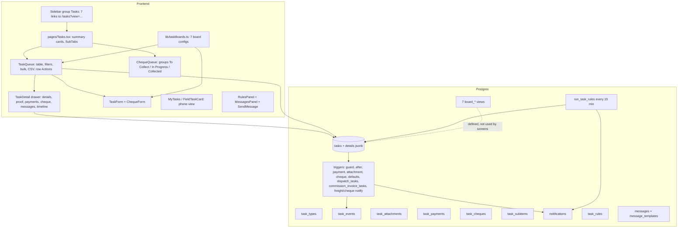
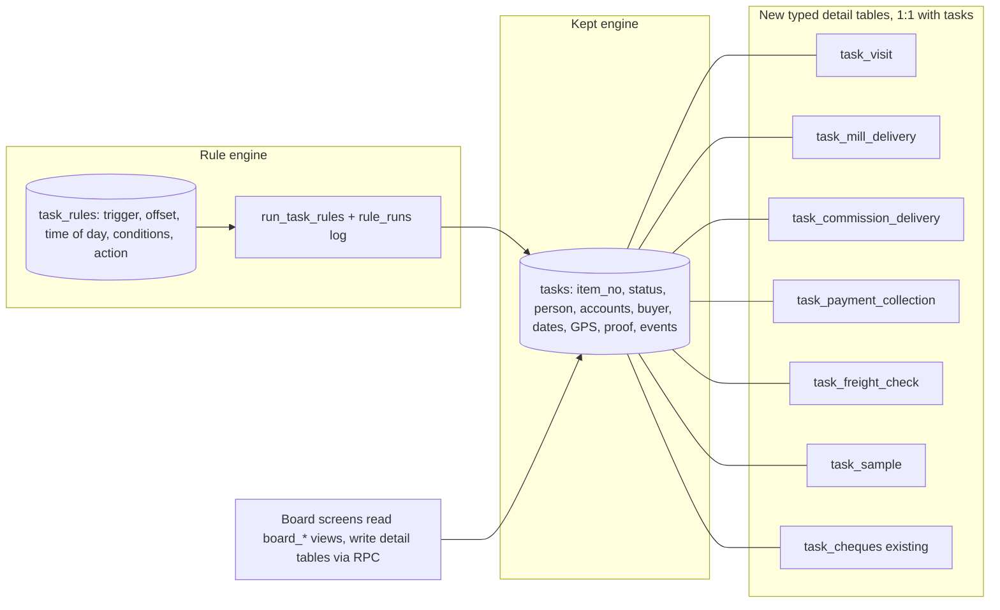

# 08. Existing codebase analysis

Inspected in `C:\crmplus\crmplus` (branch `Testing`, same code as `main` after the last push). No code was changed by this task.

## 8.1 Stack and architecture

| Layer | What is used | Where |
|---|---|---|
| Frontend | Vite 6, React 18, TypeScript, `react-router-dom`; CSS files per area (`src/styles/*.css`, `src/index.css`) | `src/` |
| Backend | **Supabase** (Postgres 15, Auth, Storage, Edge Functions on Deno, pg_cron, pg_net). There is no separate application server: business rules live in Postgres (triggers, security-definer functions, RLS) and two Edge Functions | `supabase/` |
| Database access | `@supabase/supabase-js` from the browser, with RLS; no ORM. Typed row interfaces in `src/api/types.ts` | `src/lib/supabase.ts` |
| Authentication | Supabase Auth; `AuthProvider` loads the profile and permission keys; `has_permission()` in SQL | `src/auth/AuthProvider.tsx` |
| Hosting | Vercel (production `commission-desk.vercel.app`), two branches `Testing` and `main` | |
| Notifications | `notifications` table, published on `supabase_realtime`, shown by `NotificationBell` | `src/components/NotificationBell.tsx` |
| Background jobs | `pg_cron`: `run-task-rules` every 15 minutes (SQL), a one-minute job that calls the `send-message` Edge Function with a secret | `20261118100200_tasks_scheduler.sql`, README section 6 |
| Messaging | Edge Functions `send-message` (WhatsApp Meta Cloud API templates, Resend e-mail; 3 attempts; `manual` fallback) and `whatsapp-webhook` (delivery status, replies) | `supabase/functions/` |
| Files | Private bucket `task-proofs` (20 MB limit), path `<task id>/<uuid>-<name>`, policies by task visibility | tasks migration section 8 |
| Tests | **No automated tests**: no `test` script, no test files. Verification so far is manual and by SQL probes | `package.json` |
| Reusable UI | `FormKit` (FormSection/FullWidth/Field), `RowActionMenu`, `Drawer`, `Modal`, `ConfirmDialog`, `GridKit`, `ListTools`, `SummaryCards`, `SubTabs`, `StatusPill`, `LinkPicker`, `GeoCapture`, `ProofUpload`, `PhoneField`, `DocumentList`, `lib/validate.ts`, `lib/csv.ts` | `src/components/` |

## 8.2 The Tasks module today

Key facts (all verified in code):

1. **One engine, seven views over it.** `tasks` holds every board's rows; `task_type` selects the board (`monthly_visit`, `mill_invoice_delivery`, `commission_invoice_delivery`, `payment_collection`, `freight_bill_check`, `sample_delivery`, plus `cheque_collection` whose rows are `task_cheques`). Board-specific fields live in the **`details` jsonb** (validated key by key in `task_details_problem`).
2. **`src/lib/taskBoards.ts`** is the configuration of each board: monday column titles and order, form fields, status labels, groups. The screens (`TaskQueue`, `TaskForm`, `TaskDetail`) read it; it is not a data model.
3. **The `board_*` SQL views** (migration `20261119100000`) expose monday's columns, mirrors and formulas typed, but **no screen reads them yet** (grep: no `from('board_` in `src`). They are a ready read model.
4. **Subitems**: table `task_subitems` with RLS exists; **no screen or import** uses it (grep for `subitem` in `src` is empty).
5. **Task creation from other modules**: `dispatch_tasks()` (mill invoice delivery and freight bill check from `order_dispatches`), `commission_invoice_tasks()` (from `commission_invoices`). Both use `dedupe_key` for idempotency.
6. **Automation engine**: triggers for event-style rules (proof, payment, cheque, freight outstanding, assignment) plus `run_task_rules(p_now)` for date-style rules; thresholds in `task_rules.config`; all notifications dedupe on `(user_id, dedupe_key)`; timeline in `task_events` with `dedupe_key`.
7. **Phone view**: `/tasks/my` buckets Today / Overdue / Upcoming, check-in with GPS, proof photo, payment lines, offline indicator.

## 8.3 Frontend vs monday

| Area | monday | CRM+ | Reuse |
|---|---|---|---|
| Board layout, dynamic columns | table per board | `TaskQueue` driven by `BoardConfig.columns` | keep |
| Status components | colored labels | `StatusPill` + board labels | keep |
| Item detail | item card | `TaskDetail` drawer (6 tabs) | keep, extend |
| Groups | Cheque only | `ChequeQueue` groups | keep |
| Subitems UI | none used | none | build later (low) |
| Drag and drop | rows between groups | none | not needed |
| Filters/sort | board tools | search, filter chips, quick filters, sort, CSV | keep |
| Views | table, forms, dashboards | tabs, summary cards, `TaskOverview` | add per-board dashboards |
| Automation config UI | recipes editor | `RulesPanel` (thresholds on/off, message templates) | extend to time of day |
| Cross-board relations | relation columns | links shown as text (`payment_link`, `dispatch_link`...) | link pickers per board |
| Responsive | mobile app | `MyTasks`/`FieldTaskCard`, responsive table | keep |

## 8.4 Backend vs monday (trace of each automation path)

| monday automation | CRM+ path (file / object) | Status |
|---|---|---|
| A-10 proof -> Delivered + notify | `trg_task_attachment_after` -> `auto_done_on_proof` sets `status='done'` and `details.delivery_status='delivered'`; notifies watchers except the actor with "Delivered: ..." | works; wording and recipients differ |
| A-11 commission pending payment | `run_task_rules` escalation, `delivery_pending_payment_escalation` days [0] | works; timing differs |
| A-13..A-15 payment collection | `start_date` default; `task_payment_after` notifies "Amount collected is N" and auto-completes when fully paid; `completed_at` = End Date | works; Payment Status is the generic status |
| A-17 cheque photo | `task_cheque_guard` (photo -> collected) + `cheque_collected_notify` | works |
| A-18 freight outstanding | `freight_check_notify` | works |
| A-19 sample approved -> lead | none (target missing in monday) | intentionally not built |
| A-20 sample feedback due | `run_task_rules` `sample_feedback_due` (7 days) | works; time of day differs |
| A-2 visit not visited | `run_task_rules` `visit_not_visited` on **due_date** | **incorrect** (monday: creation day 17:45) |
| A-3 visited reminder | `run_task_rules` `visit_visited_reminder`, requires `pending_payment` | **incorrect** (monday: no pending condition) |
| A-4..A-9 escalation | `run_task_rules` escalation days [30,45,60], one open follow-up per buyer | works; deliberately different (dedupe) |
| A-21..A-30 Person from Messenger | `trg_task_defaults` with `default_task_assignee` = messenger, else collection staff, else sales person; also fills Accounts from collection staff | works; differs (fallbacks, Accounts) |

## 8.5 Existing vs required architecture

**Existing**: one `tasks` table with JSON `details`; screens configured by `taskBoards.ts`; read-model views unused by the UI; rules in one big SQL function; no run log; no tests.

**Required** (document 11 detail):

Why not seven fully separate tables: the engine (`task_can` RLS, timeline, attachments, payments, notifications, message sender, field view) is keyed on `tasks.id`; a typed 1:1 detail table gives each board real columns, constraints and foreign keys with no change to those parts. This is the recommended path; a full split remains possible later because the `board_*` views already present each board as its own register.
