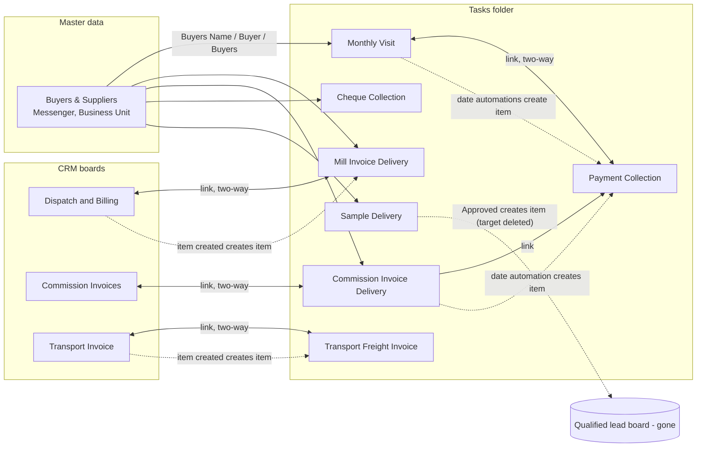

# monday.com "Tasks" folder: analysis and implementation blueprint

Read-only audit of the monday.com **Tasks** folder (workspace "CRM", id 2480519, account appsavio-corp) against the CRM+ codebase, with the plan to make CRM+ behave like the folder. Date of the audit: 2026-11-19.

**Nothing was changed in monday.com** (all calls were reads: workspace/board/view/automation/item/user/statistics reads). **Nothing was changed in the application, the database or the deployment** by this task; the only files written are the documents in this directory.

## Documents

| # | File | What it holds |
|---|---|---|
| 01 | [folder-and-board-inventory](01-folder-and-board-inventory.md) | The folder, the 7 boards (+ subitem boards), owners, members, views, rows |
| 02 | [individual-board-analysis](02-individual-board-analysis.md) | Every board: purpose, columns, labels, groups, observed data, behaviour, rules |
| 03 | [workflow-analysis](03-workflow-analysis.md) | The 9 end-to-end workflows with Mermaid flowcharts |
| 04 | [cross-board-dependencies](04-cross-board-dependencies.md) | Every relation and mirror, direction, effects; dependency map |
| 05 | [automation-inventory](05-automation-inventory.md) | All 30 automations, execution logic, edge cases, loops |
| 06 | [views-and-user-experience](06-views-and-user-experience.md) | Views, forms, filters, search, essential vs optional |
| 07 | [permissions-and-access-control](07-permissions-and-access-control.md) | monday roles and visibility vs the CRM+ permission model |
| 08 | [existing-codebase-analysis](08-existing-codebase-analysis.md) | CRM+ stack, Tasks module, what runs where; existing vs required architecture |
| 09 | [database-and-api-analysis](09-database-and-api-analysis.md) | Schema, triggers, RPCs, policies, scheduler, edge functions, entity-by-entity support |
| 10 | [feature-gap-analysis](10-feature-gap-analysis.md) | Feature-by-feature classification with files and priority |
| 11 | [implementation-roadmap](11-implementation-roadmap.md) | Phases and task cards (16 fields each), sequence, milestones |
| 12 | [automation-test-cases](12-automation-test-cases.md) | Test scenarios for every workflow and automation |
| 13 | [acceptance-criteria](13-acceptance-criteria.md) | Acceptance criteria per feature and the final checklist |

Earlier material this builds on (and corrects where noted): `docs/monday-crm-reference.md` (column catalogue of all boards), `CRMMasterPlan.md` Part 2 (P2-2 automation layer, P2-4 Tasks), `docs/mdm-column-parity.md`, `README.md` (Tasks module setup).

> **Update, second round (2026-11-19):** the seven creation forms, the reports, the app views and the Monthly Visit automation settings were read in a signed-in monday session; see `implementation-status.md`, `final-feature-matrix.md`, `creation-forms-specification.md`, `automation-offset-verification.md`, `reports-and-app-views.md`, `remaining-feature-analysis.md`, `typed-columns-architecture.md`, `board-register-specification.md`, `notification-specification.md`, `transport-invoice-dependency.md`, `staging-migration-validation.md` and `e2e-test-plan.md`.
>
> **Update, first build:** the counts below are the state at the audit. After the first implementation round (see the end of document 10) the totals are Implemented 41, Partially 7, Backend only 1, Incorrect 0, Missing 3, Needs verification 4.

## Executive summary

**Discovered**
- 1 folder ("Tasks", id 6555221) with **7 boards**: Monthly Visit, Mill Invoice Delivery, Commission Invoice Delivery, Payment Collection, Cheque Collection, Transport Freight Invoice, Sample Delivery. 2 further boards are the default **subitem boards** of Payment Collection and Cheque Collection (plus one stray duplicate "Subitems of Cheque Collection"). All seven are public boards owned by one admin; no nested folders.
- **9 end-to-end workflows** (document 03): buyer-messenger assignment, monthly-visit lifecycle, unpaid-visit escalation to Payment Collection, mill invoice delivery, commission invoice delivery and pending payment, payment collection, cheque collection, freight bill check, sample delivery and feedback.
- **30 automations**: 20 workflow-engine automations (18 active, 2 inactive) and 10 legacy "update column from lookup" recipes (all active). Nine of the 20 sit on Monthly Visit. monday's run statistics show **0 executions recorded** on every board.
- 7 creation forms (app views), 6 "Reports" dashboard views + 1 "Dashboard" on Monthly Visit, 4 "Build Vibe view" app views, 1 "Commission Invoice From" app view. Their contents cannot be read through the read-only API (listed as unverified).
- Real usage is light: 82 rows in total (3 + 26 + 31 + 0 + 1 + 20 + 1), most with few columns filled.

**CRM+ against monday (document 10: 56 features classified)**
- Implemented: **29**. Partially implemented: **12**. Backend only: **2**. UI only: 0. Incorrect (differs from monday): **3**. Missing: **6**. Needs verification: **4**.
- Counts come from the table in document 10 (totals section).

**Most critical gaps**
1. **Two visit reminders are wrong** (F-28, F-29): "Not Visited" fires on the due date (30 days after creation) instead of the creation day at 17:45, and the 30-day visited reminder requires "pending payment", which monday does not check.
2. **Person assignment differs**: monday copies only the buyer's *Messenger* into Person and leaves Accounts manual; CRM+ falls back to collection staff / sales person and also fills Accounts.
3. **Boards are views over one `tasks` row with a `details` JSON**, so board-specific fields have no types, constraints or foreign keys; subitems exist only in the database (no screen).
4. **Date-trigger times of day** (17:45, 18:30, 20:30 IST ...) are not honoured; CRM+ rules run every 15 minutes whenever the date has passed.
5. **No Transport Invoice register**: monday's freight boards are fed by Transport Invoice; CRM+ feeds them from the dispatch row.
6. **monday creation forms are unread** (embedded app views), so form sections, order and required marks are unverified.

**Recommended sequence** (document 11): (0) confirm the unread items in monday with an editor session, (1) fix the four incorrect automations and Person assignment, (2) typed detail tables per board behind the existing engine plus relations, (3) per-board screens with monday's creation-form sections, subitems and Actions, (4) time-of-day triggers and an automation run log, (5) Transport Invoice link and monday data import, (6) tests and cut-over.

**Access limitations / unverified** (full list in each document and in 13): creation-form sections and required marks; contents of the Reports/Dashboard/Build Vibe/"Commission Invoice From" views; date-trigger offsets of the six Monthly Visit escalation automations (the stored configuration shows no offset although the messages say 30/45/60 days); which of the two people columns on each board is "People" and which "Accounts" (inferred from the data); the Person recipient of the Commission Invoice Delivery automation (it points to a `person` column the board no longer has); permissions of non-admin members and guests; email/mobile delivery of monday notifications (account-level setting).

## Cross-board architecture

